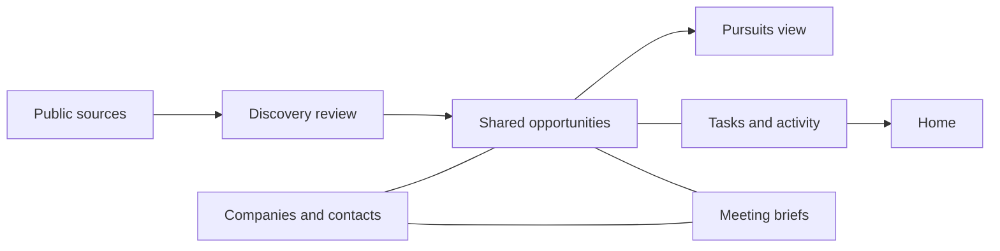

# Kulka CRM plan

This is the proposed product plan for LA-226, prepared September 5, 2026, Eastern time.
Matt asked for the whole CRM plan and additional Long Island sources. This document
sets the direction and build order. It does not claim these features exist.

## Direction

Build a shared CRM around projects and relationships. Vision finds and qualifies
opportunities. Pursuits manages the work Kulka chooses to pursue. Companies and
contacts connect both views. Home tells each person what needs attention.

Keep discovery records separate from commercial pipeline totals. Several filings
may concern one project, and separate projects may share an address. Preserve each
source and let a reviewer link it to an existing opportunity or create a new one.
This requires more review than automatic address merging, but avoids false deal
counts and lost evidence. Suggest likely matches to reduce repeat work.

Use one opportunity record from initial qualification through the sales outcome.
Pursuit is a view of that record after the team chooses to pursue it. A separate
pursuit database would duplicate owners, notes, contacts and stage history.
A future paid engagement belongs to a won opportunity; it must not replace it.

## Current state

At commit 04e988a, Vision has persistent schema and server routes for saved
opportunities, notes, review status, source snapshots and discovery acceptance.
The local preview uses a disposable database. Nassau is the only automated source.
Clients, Pursuits, Briefs and Home are empty application shells. Reference HTML
shows design intent, not real client records or implemented CRM behavior.

Current review statuses are Not started, Working on it, Stuck and Done. They
measure review work. Done does not mean a won contract. The current auth gate
controls authorized writers but does not supply CRM roles or record ownership.
The CRM must add those concepts rather than infer them from existing fields.

The current DESIGN.md and daylight.css govern every view. Earlier Blackline and
CRM-only notes do not override the present app, which also has budgeting and
underwriting modules. Those modules remain separate and may later link to a CRM
opportunity without copying their calculations into it.

## Core records

| Record | What it holds | Relationships and rules |
| --- | --- | --- |
| Source record | Authority, application identifier, source URL, document/page, source dates, first seen, last checked, versions and extraction state. | Many records can support an opportunity. Linking records does not erase their identities or review history. |
| Opportunity | Name, scope, territory, project type, qualification, review status, sales stage, responsible staff member and outcome. | This is the shared Vision/Pursuits record. It can start without a known company or site. |
| Site | Address, jurisdiction, parcel references, coordinates and location precision. | An opportunity can span multiple sites. A site can host multiple phases or unrelated opportunities. Address alone is not identity. |
| Company | Legal/display names, aliases, website, relationship owner and relationship type. | One company may be a prospect, client, developer, owner or partner in different relationships. A client is a company with a client relationship, not every named applicant. |
| Contact | Person, public or user-provided business contact details, provenance and contact preferences. | Company affiliations have roles and dates. Moving companies must not rewrite past activity. |
| Opportunity party | A company or contact and its role in this opportunity. | Owner, applicant, developer, architect, engineer, broker, referral partner and decision maker are distinct. A filing's applicant is not proof of property ownership. |
| Task | Assignee, next action, due date, completion state and optional reminder. | Tasks link to an opportunity or company. One open task can be marked as the primary next action. |
| Activity | Call, meeting, note, completed task, stage change or linked correspondence. | Keep author, event time, created time and source. Corrections retain history. |
| Brief | Reviewed preparation for a meeting, with linked facts and open questions. | Generated text stays a draft until accepted. It links to contacts, companies and opportunities. |
| Attachment | Document metadata, access, version and source. | Store once and link to records. A source document and a team-authored document retain different provenance. |

Assign staff using authenticated member IDs. Record the property owner through
an opportunity party. Do not use one ambiguous owner field for both.
Unknown value, date, contact or project scope stays unknown. Separate total
project cost from the value of Kulka's potential work, with currency and evidence
on each. Never fill either from an unsupported estimate or automatic fit score.

## End-to-end workflow

1. Collect a source item and retain its original evidence. Classify it as a
   project/application, a policy change or uncertain. A policy notice stays useful
   context but does not automatically count as a project or acquire a map pin.
2. Review the item. Dismiss with a reason, keep it for review, link it to an
   existing opportunity, or create an opportunity. Repeating the action must not
   create a duplicate. A later source revision must not replace team notes.
3. Qualify the opportunity using project type, location, scope, timing, known
   parties, relationship access and the reason Kulka would pursue it. Unknowns
   become explicit research tasks. No fixed dollar cutoff is assumed.
4. Choose whether to monitor, pursue or pass. Require a responsible staff member,
   a written reason and a next action when starting active pursuit. A missing
   contact is a research task, not grounds to invent a person.
5. Log outreach and meetings, update the sales stage, and complete or reassign
   tasks. Record what happened rather than marking outreach sent from a draft.
6. Record the outcome and reason. A won opportunity requires recorded award
   evidence. A lost opportunity records the known reason or says it is unknown.
   Reopening preserves the prior outcome and stage history.

### Proposed sales stages

These are starter defaults, not a claim about Kulka's existing sales process.

| Stage | Meaning and entry evidence |
| --- | --- |
| Qualifying | The team is assessing scope, parties and relevance. This is not active pipeline. |
| Monitoring | There is a reason to keep watching and a next review date. This is not active pipeline. |
| Outreach | Kulka has chosen to pursue, assigned a person and set the next action. |
| Engaged | A logged two-way contact or meeting establishes engagement. |
| Proposal | The team is preparing or has delivered a proposal. Track draft and delivered dates separately. |
| Negotiation | A logged exchange shows that terms or award are under discussion. |
| Won | A user records award evidence and the award date. |
| Lost | A user records the outcome date and reason, if known. |
| Passed | Kulka chooses not to pursue and records why. |

Stages may move backward with a reason. Review status stays separate. Do not
convert old Done records to Won during migration. Start old saved records at
Qualifying, preserve their IDs, links, notes and review state, and mark qualification
as pending. Unassigned legacy records appear in a clear team queue.

## Screens and daily work

| Surface | Primary job |
| --- | --- |
| Home | Show my overdue tasks, tasks due soon, unassigned work and source changes awaiting review. Each item opens the record that needs action. |
| Vision | Provide linked map/list views, source review and qualification. Separate discovery, monitored and pursued counts. Retain records without coordinates in the list. |
| Opportunity record | Show summary and next action first, followed by parties, activity, source evidence, documents and linked budgeting/underwriting records. |
| Pursuits | Show active opportunities grouped by sales stage, with owner, next action, due date, company and value basis. Support list and board views using the same records. |
| Companies | Replace the empty Clients shell with all business relationships and a Clients saved view. Provide related contacts, opportunities and activity. |
| Contacts | Find people across companies and projects. Show their role, source, last logged contact and contact preferences. |
| Briefs | Prepare for a meeting from selected records, link every factual claim to evidence, and review the draft before use. |
| Sources | Show jurisdiction, record types, collection method, covered dates, last completed check, failures and missing location counts. |

Use Daylight's existing color tokens, typography, sheets and status chips.
Blue identifies discoveries. Review colors keep their current meanings. Sales
stages use labeled groups; overdue tasks use red attention treatment. Do not
assign competing color schemes to stages, project types and urgency on one pin.
Selection needs an outline and label as well as color. Every map result must be
reachable in a keyboard-accessible list. Filter and view choices live in the URL.

Search names, aliases, source identifiers, addresses and approved notes. Saved
views include My pursuits, Unassigned, Due this week, Monitoring and Recently
changed sources. A user must always see whether a count is filtered or capped.

## Imports, shared work and controls

Start with manual company/contact entry and a CSV import preview. The importer
shows field mapping, errors and likely duplicates before a user accepts rows.
Keep a batch ID and row results so retries do not duplicate accepted records.
Source intake proposes company/contact links; it never silently creates a whole
address book from a hearing packet.

Proposed roles are administrator, editor and viewer within Kulka. Every server
read and write must enforce workspace membership. Editors may manage shared CRM
records; administrators manage membership, merges and exports. Temporary preview
access must never expose private contacts, notes or attachments. Build and test
that boundary before loading business data. Changing production access requires
separate approval.

Use revision checks for concurrent edits. Record who changed assignments, stages,
links and outcomes. Merging requires a field-by-field review and a retained
redirect/history; do not destructively merge source evidence. Archive records
without deleting their activity. Reassign open work when a staff member leaves.

Keep tasks and reminders inside the app first. Email/calendar and meeting imports
are later integrations with connection scope, deduplication and review rules.
Nothing automatically sends an email or posts a message. Drafting, approving and
sending must be separate states with separate authority.

Reports count distinct opportunities and disclose their stage/date filters.
Start with pipeline by stage and owner, overdue work, time in stage and source
conversion. Exclude discoveries, Monitoring and Passed from active pipeline.
Unknown money stays outside known-value totals with its count shown. Weighted
forecasts wait for an agreed value basis and probabilities supported by history.

## Build order and acceptance

These are product phases, not published execution tickets. Break each approved
phase into one-job issues when its implementation spec is ready.

| Order | Delivery | Acceptance evidence |
| --- | --- | --- |
| 1 | Shared companies, contacts, staff assignments and opportunity links. | One company can support two opportunities; one contact can hold distinct project roles; imports detect repeat rows; unauthenticated and wrong-workspace access fail. Existing Vision URLs and notes still work. |
| 2 | Suffolk source collection into the existing review inbox, plus source-to-opportunity linking. | Repeated collection is idempotent; changed documents retain history; policy items do not inflate deal counts; duplicate suggestions never silently merge. Incomplete location stays off the map. |
| 3 | Qualification and Pursuits using the same opportunity record. | A reviewed discovery becomes one pursuit; stage changes retain actor/time/reason; review Done never means Won; cards and map/list views agree. |
| 4 | Tasks, activity and Home. | Two staff members can assign and complete work without lost updates; due dates use America/New_York; date-only tasks become overdue after the due day; closed work leaves the active queue. |
| 5 | Islip, Oyster Bay and Hempstead imports, then deeper town coverage. | Each source passes its own fixture, live-sample, update, identity and failure checks before it joins regular collection. |
| 6 | Briefs, document links, approved imports and reporting. | Brief facts link to evidence; missing facts remain open questions; pipeline totals reconcile to records; role checks apply to attachments and exports. |
| 7 | Approved production pilot and later connected workflows. | Verify migration and rollback on a staging copy, login/member permissions, persistence across restart, source schedule recovery, audit history and a full two-user work cycle. Production changes require approval. |

Prepare the full product model now; implement the smallest useful phases in this
order. Do not activate a second source just to show a larger marker count.
The first implementation job is the shared company/contact and opportunity-link
foundation. The next collector is Suffolk County Planning Commission.

## Scenarios that the model must survive

- A county referral and town hearing refer to the same application. Keep two
  sources and one reviewed opportunity link; count one pursuit.
- Two buildings or phases share a parcel and developer. Keep distinct opportunities
  when their scopes or commercial decisions differ.
- A zoning moratorium affects many parcels. Store territory-level context without
  inventing one project, owner or pin at the town center.
- A consultant appears as applicant for several owners. Store the documented role;
  do not merge those owners or assign ownership to the consultant.
- A contact changes companies. Preserve prior activity and dated affiliations.
- A source revises a project after the team passes. Show the change for review;
  do not reopen the sales stage without a user action.
- A record loses its source URL or location. Preserve prior evidence, show source
  health, and keep it reachable without a map marker.

## Assumptions to validate during the first usable slice

Use one shared Kulka workspace, project-led selling, and the proposed stages above.
Do not assume a project-size minimum, weighted forecast, existing client import,
email provider, outbound automation or a separate acquisition CRM. Those choices
can refine the first screens without holding up the record foundation. If land
acquisition needs a separate sales process, give it a separate stage definition
while sharing sites, companies, contacts and source evidence.

See [Long Island source plan](long-island-sources.md) for source evidence and the
collector acceptance contract. No CRM feature, extra collector or production
setting changed as part of this planning job.
